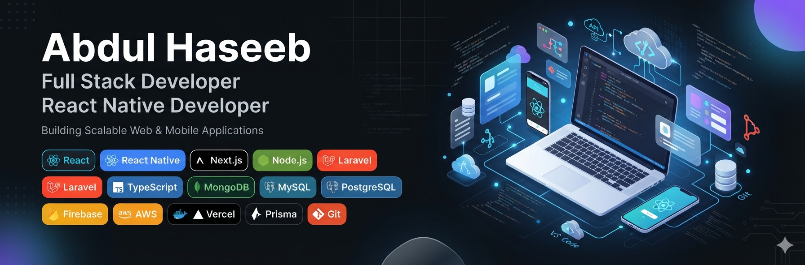

<!-- ========================================= -->
<!--              GITHUB BANNER               -->
<!-- ========================================= -->

  

<h1 align="center">
Hi 👋, I'm Abdul Haseeb
</h1>

<h3 align="center">
🚀 Senior Full Stack Developer | React Native Developer | React.js · Next.js · Node.js · Laravel
</h3>

  

<b>Abdul Haseeb</b> is a Full Stack Developer and React Native Developer from Karachi, Pakistan with <b>5+ years</b> of experience building custom web applications, cross-platform <b>Android & iOS apps</b>, <b>SaaS</b>, <b>ERP / HRM / CRM</b> software, <b>school management systems</b> and <b>e-commerce</b> platforms with React.js, Next.js, Node.js, Laravel and PHP. Open to remote full-time and freelance roles.

---

# 👨‍💻 About Me

💻 **Full Stack Developer** and **React Native Developer** building scalable web apps, mobile apps and custom business software for startups and companies in Pakistan, the UAE, Europe and the US.

📱 Shipped **15+ production applications** from UI design to deployment on the App Store and Google Play.

🚀 Core stack:

- **Mobile:** React Native (CLI & Expo), TypeScript, Firebase, push notifications
- **Web:** React.js, Next.js, JavaScript (ES6+), Tailwind CSS
- **Backend:** Node.js, Express, Laravel, PHP, CodeIgniter, Prisma
- **APIs:** REST API development, GraphQL, API integration, payment gateway integration
- **E-commerce:** Laravel e-commerce, Magento, PrestaShop, multi-vendor marketplaces

🔥 What I've built:

- Food delivery, grocery delivery, ride booking and logistics apps (customer, driver and merchant apps)
- Multi-vendor marketplaces and e-commerce websites & apps
- Real estate CRM, property management and property listing websites
- ERP, HRM, inventory, POS and business automation software
- School management and education software
- SaaS applications and admin dashboards
- Service booking apps (home cleaning services) and fitness apps

🌱 Currently learning

- System Design
- Microservices
- Kubernetes
- AWS
- AI Integrations
- CI/CD Pipelines

---

# 🚀 Tech Stack

## Frontend

## Mobile

## Backend

## Database

## Cloud & Tools

---

# 💼 Featured Projects

## 🚚 Grubsy: Food Delivery Platform

Customer, driver and merchant apps with a React admin panel and a Node.js API.

✔ Customer App · ✔ Driver App · ✔ Merchant App · ✔ Admin Dashboard · ✔ Live Tracking · ✔ Push Notifications · ✔ Payment Integration

**Tech Stack:** React Native • Expo • React.js • Node.js • Prisma

---

## 🛒 Azaro: Multi Vendor Marketplace

✔ Vendor Onboarding & Dashboards · ✔ Customer App · ✔ Admin Panel · ✔ Commission & Payouts · ✔ Order Tracking

**Tech Stack:** React Native • Laravel

---

## 🥦 Rizq Mart: Grocery Delivery App

Android & iOS grocery shopping app with a Laravel REST API, payments and real-time order tracking.

[Website](https://rizq-mart.com/) · [App Store](https://apps.apple.com/us/app/rizq-mart/id6753622737) · [Google Play](https://play.google.com/store/apps/details?id=com.rizq.mart)

**Tech Stack:** Flutter • Laravel • PHP • MySQL

---

## 🏠 Four Apple & Jamoka: Real Estate CRM

✔ Lead Management · ✔ Property Management · ✔ Agent Mobile App · ✔ Appointment Scheduling · ✔ Reports & Analytics

**Tech Stack:** React Native • Laravel

---

## 🍳 DishDish: Recipe Platform

[Website](https://dishdish.us/) · [App Store](https://apps.apple.com/us/app/dish-dish-online-cookbook/id649276240) · [Google Play](https://play.google.com/store/apps/details?id=com.dishdish.cookbook)

**Tech Stack:** React Native • Laravel • MySQL

---

## 🛍 Adil Store & SuperGallery: E-commerce

Supermarket e-commerce app for the Gulf region, and a PrestaShop + React.js store for the Netherlands.

[Adil Store](https://adilstore.com/) · [SuperGallery.nl](https://www.supergallery.nl/)

**Tech Stack:** React Native • Magento API • PrestaShop • React.js • PHP • Docker

---

👉 Full list with case studies: **[abdul-haseeb-portfolio-eta.vercel.app](https://abdul-haseeb-portfolio-eta.vercel.app/#projects)**

---

# 📈 Coding Activity

- 📱 15+ Production Applications
- 🚀 Full Stack Development
- 🌍 REST API Integration
- ⚡ Performance Optimization
- ☁ Cloud Deployment
- 📦 Play Store & App Store Releases

---

# 💡 What I Build

✅ Custom Web Application Development (React.js, Next.js, Laravel, Node.js)

✅ Cross-Platform Mobile Apps for Android & iOS (React Native)

✅ SaaS Applications & Admin Dashboards

✅ ERP, HRM, Payroll, Inventory & POS Software

✅ CRM Software (Sales & Real Estate)

✅ School Management Systems & LMS

✅ E-commerce Websites, Apps & Multi Vendor Marketplaces

✅ Food Delivery, Grocery, Ride Booking & Logistics Apps

✅ REST & GraphQL APIs, Payment Gateway Integration

✅ Website Performance Optimization, Maintenance & Migration

---

# 🤝 Let's Connect

---

# 💬 Favorite Quote

> **"Great software is built by solving real problems with clean code, thoughtful design, and continuous learning."**

---

### ⭐ Thanks for visiting my profile!

If you like my work, consider giving a ⭐ to my repositories.

